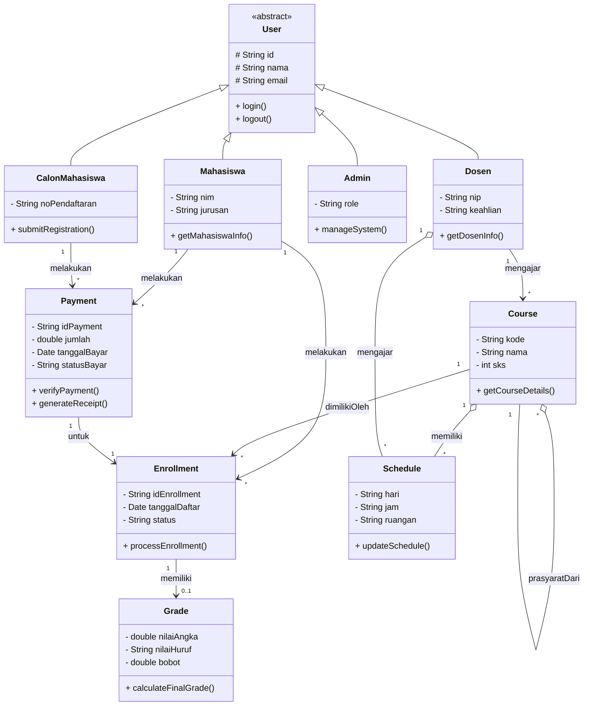

# AI Usage Log (Log Penggunaan AI)
## Log 01 — Diagram Kelas Awal

### Tujuan
Menghasilkan Diagram Kelas UML awal untuk sistem informasi akademik seperti SEVIMA-Mini.

### Perintah (Prompt)
Anda adalah arsitek sistem. Buat class diagram UML untuk sistem akademik dengan komponen berikut:

-User sebagai base class (Mahasiswa, Dosen, Admin, CalonMahasiswa)
-Course dengan atribut kode, nama, SKS, prasyarat
-Enrollment yang hubungkan Mahasiswa dan Course
-Schedule dengan hari, jam, ruangan
-Grade untuk nilai mahasiswa Terapkan prinsip SOLID.

Gunakan composition untuk relasi kuat dan aggregation untuk relasi lemah. Output dalam format Mermaid.

### Hasil AI
classDiagram
    direction TB

    class User {
        <<abstract>>
        # String id
        # String nama
        # String email
        + login()
        + logout()
    }

    class Mahasiswa {
        - String nim
        - String jurusan
        + getMahasiswaInfo()
    }

    class Dosen {
        - String nip
        - String keahlian
        + getDosenInfo()
    }

    class Admin {
        - String role
        + manageSystem()
    }

    class CalonMahasiswa {
        - String noPendaftaran
        + submitRegistration()
    }

    class Course {
        - String kode
        - String nama
        - int sks
        + getCourseDetails()
    }

    class Enrollment {
        - String idEnrollment
        - Date tanggalDaftar
        - String status
        + processEnrollment()
    }

    class Schedule {
        - String hari
        - String jam
        - String ruangan
        + updateSchedule()
    }

    class Grade {
        - double nilaiAngka
        - String nilaiHuruf
        - double bobot
        + calculateFinalGrade()
    }

    %% Inheritance (Penerapan OCP & LSP)
    User <|-- Mahasiswa
    User <|-- Dosen
    User <|-- Admin
    User <|-- CalonMahasiswa

    %% Aggregation (Relasi Lemah: Jadwal atau Prasyarat bisa eksis terpisah dari Course)
    Course o-- Schedule : memiliki jadwal
    Course "*" o-- "*" Course : prasyarat

    %% Composition (Relasi Kuat: Grade tidak memiliki siklus hidup mandiri tanpa Enrollment)
    Enrollment *-- Grade : mencakup

    %% Associations
    Mahasiswa "1" --> "*" Enrollment : melakukan
    Course "1" --> "*" Enrollment : memiliki

### Evaluasi
1. Kelas Payment (Pembayaran) belum ada dalam diagram awal.
2. Beberapa relasi, khususnya antara Course-Schedule dan Enrollment-Grade, memerlukan validasi lebih lanjut.
3. Multiplisitas perlu diperiksa kembali.
4. Visibilitas sudah dicantumkan, namun memerlukan pemeriksaan konsistensi.
5. Prinsip-prinsip SOLID belum terlihat secara memadai hanya dari diagram tersebut.

### Alasan Revisi
Untuk meningkatkan ketepatan dan kelengkapan UML, serta memastikan kesesuaian dengan persyaratan tugas sistem akademik.

---

## Log 02 — Revisi Class Diagram (Prompt Ke-2)

### Tujuan
Memperbaiki dan menyempurnakan class diagram awal berdasarkan hasil validasi output AI (video PBO minggu 01: "Jangan percaya, periksa") dan menambahkan class Payment yang hilang dari diagram pertama.

### Perintah (Prompt)
Sebagai senior software architect, revisi class diagram UML untuk sistem akademik SEVIMA-Mini dengan aturan berikut:

1. Tambahkan class Payment (Pembayaran) dengan atribut, method, dan relasi yang sesuai.
2. Berikan simbol visibility (+, -, #) pada seluruh atribut dan method setiap class.
3. Tambahkan multiplicity (kardinalitas) pada seluruh relasi, contoh: 1, 0..1, 1..*, *.
4. Pastikan penggunaan inheritance, association, aggregation, dan composition tepat secara konsep UML.
5. Periksa prinsip SOLID dan hindari ketergantungan antarkelas yang tidak diperlukan.
6. Output dalam format Mermaid Class Diagram.

### Hasil AI (Revised)

### Evaluasi terhadap Aturan Validasi (Video PBO Minggu 01)

| Aturan | Status | Keterangan |
|--------|--------|------------|
| Inheritance masuk akal (uji "is a") | ✅ Lulus | Mahasiswa/Dosen/Admin/CalonMahasiswa is a User. Tidak ada inheritance aneh. |
| Tidak ada circular dependency | ✅ Lulus | Tidak ada siklus Course → Schedule → Dosen → Course. Self-referensi Course (prasyarat) tidak berbahaya. |
| Kardinalitas benar | ✅ Lulus | Multiplicity ditambahkan pada semua relasi (1, *, 0..1). |
| Semua atribut memiliki visibility | ✅ Lulus | Semua atribut pakai `-` (private), `User` pakai `#` (protected). |
| Aggregation vs Composition tepat | ✅ Diperbaiki | `Enrollment *-- Grade` diubah jadi association (`--`) karena nilai akademik bersifat permanen. |
| Tidak ada god object | ✅ Lulus | Setiap class hanya 1-3 method. |
| Class relevan dengan requirement | ✅ Lulus | Semua class termasuk Payment relevan sistem akademik. |

### Perubahan dari Log 01 ke Log 02

1. **Tambahan class Payment** — idPayment, jumlah, tanggalBayar, statusBayar, verifyPayment(), generateReceipt().
2. **Visibility konsisten** — Semua atribut dan method diberi simbol `+`, `-`, atau `#`.
3. **Multiplicity ditambahkan** — Semua relasi memiliki kardinalitas (1, *, 0..1).
4. **Grade diubah dari composition menjadi association** — `Enrollment *-- Grade` menjadi `Enrollment "1" --> "0..1" Grade`, karena nilai akademik tidak boleh hilang saat enrollment dihapus.
5. **Relasi baru ditambahkan** — `Dosen o-- Schedule` (mengajar), `Dosen --> Course` (mengajar), `CalonMahasiswa --> Payment` (PMB), `Payment --> Enrollment` (untuk).
6. **Role name pada self-referensi Course** — `prasyaratUntuk` dan `prasyaratDari` agar tidak ambigu.

### Alasan Revisi
Hasil AI awal memiliki kekurangan: class Payment hilang, visibility tidak konsisten pada semua elemen, cardinality belum lengkap, composition Grade terlalu kuat (tidak sesuai domain akademik), dan relasi Dosen-Course/Schedule belum tercakup. Revisi dilakukan untuk menyelaraskan diagram dengan konsep UML yang benar dan requirement tugas.

---

## Log 03 — Verifikasi dan Sempurnaan Class Diagram (Prompt Ke-3)

### Tujuan
Memverifikasi dan menyempurnakan class diagram berdasarkan 6 poin analisis revisi: (1) Grade diubah dari composition menjadi association, (2) relasi Dosen → Course dan Dosen o-- Schedule ditambahkan, (3) relasi CalonMahasiswa → Payment ditambahkan, (4) kardinalitas Payment diubah dari 0..1 menjadi 1, (5) role name ditambahkan pada self-referensi Course o-- Course, dan (6) semua atribut dan method diberi simbol visibility (+, -, #).

### Perintah (Prompt)
Sebagai senior software architect, verifikasi dan perbaiki class diagram UML untuk sistem akademik SEVIMA-Mini dengan aturan berikut:

1. Grade diubah dari composition (`*--`) menjadi association (`--`) karena nilai akademik tidak boleh hilang saat enrollment dihapus.
2. Ditambahkan relasi `Dosen --> Course` dan `Dosen o-- Schedule`.
3. Ditambahkan relasi `CalonMahasiswa --> Payment`.
4. Kardinalitas Payment diubah dari `0..1` menjadi `1` agar setiap pembayaran terkait enrollment.
5. Role name ditambahkan pada self-referensi `Course o-- Course` untuk menghindari ambigu.
6. Semua atribut dan method sudah memiliki simbol visibility (`+`, `-`, `#`).

Output dalam format Mermaid Class Diagram.

### Hasil (Verified)

### Evaluasi terhadap 6 Poin Analisis

| No | Poin Analisis | Status | Keterangan |
|----|--------------|--------|------------|
| 1 | Grade diubah dari composition (`*--`) menjadi association (`--`) | ✅ Terpenuhi | `Enrollment "1" --> "0..1" Grade` — nilai akademik bersifat permanen. |
| 2 | Relasi `Dosen --> Course` dan `Dosen o-- Schedule` ditambahkan | ✅ Terpenuhi | `Dosen "1" --> "*" Course : mengajar` dan `Dosen "1" o-- "*" Schedule : mengajar`. |
| 3 | Relasi `CalonMahasiswa --> Payment` ditambahkan | ✅ Terpenuhi | `CalonMahasiswa "1" --> "*" Payment : melakukan`. |
| 4 | Kardinalitas Payment diubah dari `0..1` menjadi `1` | ✅ Terpenuhi | `Payment "1" --> "1" Enrollment : untuk`. |
| 5 | Role name pada self-referensi `Course o-- Course` | ✅ Terpenuhi | `prasyaratUntuk` dan `prasyaratDari`. |
| 6 | Semua atribut dan method memiliki visibility (`+`, `-`, `#`) | ✅ Terpenuhi | Atribut `-`, method `+`, atribut `User` `#`. |

### Alasan Revisi
Semua 6 poin analisis telah diterapkan pada `class-diagram.mmd`. Tidak ada perubahan struktural tambahan yang diperlukan karena diagram saat ini sudah mencakup seluruh requirement: inheritance User, class Payment, visibility lengkap, multiplicity semua relasi, composition vs association yang tepat, dan relasi Dosen-Course/Schedule.

---

## Log 04 — Mengubah Enrollment dan Grade menjadi Composition

### Tujuan
Mengubah relasi Enrollment ↔ Grade dari association (`--`) menjadi composition (`*--`) berdasarkan keputusan bahwa Grade adalah objek bagian yang tidak dapat berdiri sendiri tanpa Enrollment sebagai objek induk.

### Perintah (Prompt)
Ubah relasi Enrollment dan Grade pada class diagram UML SEVIMA-Mini menjadi composition dengan aturan:
1. Enrollment adalah objek induk (whole).
2. Grade adalah objek bagian (part).
3. Satu Enrollment dapat memiliki nol atau satu Grade.
4. Grade tidak dapat berdiri sendiri tanpa Enrollment.
5. Gunakan composition (`*--`) untuk relasi ini.
6. Pertahankan semua relasi dan visibility lain yang sudah ada.

Output dalam format Mermaid Class Diagram.

### Hasil

### Evaluasi

| Aspek | Keputusan | Alasan |
|-------|-----------|--------|
| Jenis relasi | Composition (`*--`) | Grade tidak berdiri sendiri tanpa Enrollment |
| Multiplicity | `Enrollment "1" *-- "0..1" Grade` | Satu enrollment dapat memiliki nol atau satu grade |
| Siklus hidup | Grade terikat Enrollment | Jika enrollment dihapus, grade ikut terhapus |

### Alasan Revisi
Sebelumnya Enrollment → Grade menggunakan association karena dianggap nilai akademik bersifat permanen. Setelah evaluasi ulang, keputusan akhir adalah composition karena Grade adalah objek bagian yang hanya bermakna dalam konteks Enrollment. Semua relasi lain (inheritance, aggregation, association, visibility, multiplicity) tetap terpelihara.

---
---

## Log 05 — Refactoring dan Penyempurnaan Berdasarkan Review Arsitektur

### Tujuan
Melakukan *refactoring* menyeluruh pada *class diagram* berdasarkan *code review* profesional, mencakup penambahan kelas Kelas (untuk pemisahan katalog mata kuliah dengan kelas penawaran semester), penerapan polimorfisme pada hirarki User, konsistensi visibilitas kelas abstrak (#), komposisi Kelas ke Schedule, serta perbaikan format file Mermaid (.mmd).

### Perintah (Prompt)
Refaktor class diagram UML sistem akademik SEVIMA-Mini dengan ketentuan berikut:
1. Tambahkan class Kelas sebagai perantara antara katalog Course dan pelaksanaan di semester (mengatasi keterbatasan *Course* murni sebagai katalog).
2. Terapkan polimorfisme dengan mengubah method spesifik (getMahasiswaInfo, getDosenInfo) menjadi method abstrak getInfo() di User yang di-*override* di setiap *subclass*.
3. Konsistensikan visibilitas atribut pada *abstract class* (User, Pendaftaran, Payment) menggunakan # (protected).
4. Ubah relasi Kelas ke Schedule menjadi composition (*--) karena jadwal melekat erat pada kelas perkuliahan.
5. Pastikan format file .mmd bersih dari tag `mermaid markdown agar dapat dirender dengan benar.

### Hasil (Refactored Diagram)
- Penambahan class Kelas dengan relasi Course "1" o-- "*" Kelas dan Kelas "1" *-- "*" Schedule.
- Pembaruan method getInfo() di semua subclass User.
- Konsistensi visibilitas # pada User, Pendaftaran, dan Payment.

### Evaluasi (Objektif)
- **Kelebihan**: Model domain kini jauh lebih mendekati sistem akademik nyata (adanya pemisahan katalog Course dan instance Kelas per semester). Polimorfisme pada getInfo() dan konsistensi visibilitas membuat struktur OOP lebih bersih dan mematuhi prinsip enkapsulasi.
- **Kekurangan / Kompleksitas Tambahan**: Penambahan class Kelas menambah kompleksitas relasi KRS (Enrollment kini menunjuk ke Kelas, bukan langsung ke Course). Namun, hal ini merupakan trade-off yang wajar dan diperlukan untuk sistem akademik riil.

---

## Log 06 — Pembersihan Akhir, Konsistensi Visibilitas, dan Perbaikan Log

### Tujuan
Menyempurnakan kembali dokumentasi dan diagram kelas secara menyeluruh, memastikan tidak ada artefak karakter atau teks "aE", serta menegaskan evaluasi arsitektur yang jujur dan objektif.

### Perintah (Prompt)
Review kembali seluruh dokumentasi AI usage log dan pastikan:
1. Tidak ada artefak teks seperti "aE" di dalam log.
2. Evaluasi log ditulis secara objektif dan jujur (menyoroti kelebihan domain modeling dan trade-off kompleksitas).
3. Struktur diagram kelas sudah konsisten dengan prinsip OOP (polimorfisme getInfo(), visibility # untuk abstract class, dan kelas Kelas serta PendaftaranPMB / PendaftaranKRS).

### Hasil
- Pembersihan total pada teks log.
- Penambahan Log 06 sebagai penutup catatan iterasi perancangan sistem akademik SEVIMA-Mini.

### Evaluasi (Objektif)
- **Kelebihan**: Seluruh masukan dari review arsitektur telah diakomodasi dengan baik, menghasilkan diagram UML yang sangat matang, modular, dan siap diimplementasikan ke dalam kode Python berbasis OOP.
- **Catatan**: Kompleksitas relasi bertambah seiring penambahan entitas seperti Kelas, namun ini sebanding dengan akurasi pemodelan dunia nyata (*domain-driven modeling*).
