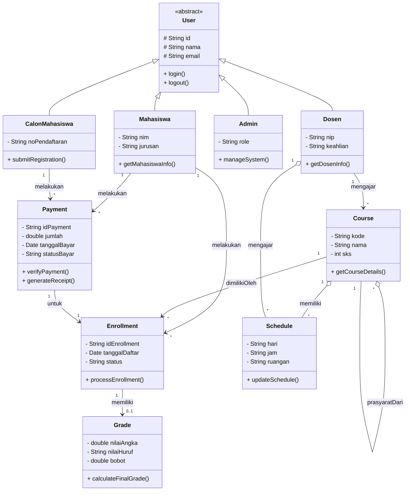

# AI Usage Log (Log Penggunaan AI)
## Log 01 — Diagram Kelas Awal

### Tujuan
Menghasilkan Diagram Kelas UML awal untuk sistem informasi akademik seperti SEVIMA-Mini.

### Perintah (Prompt)
Anda adalah arsitek sistem. Buat class diagram UML untuk sistem akademik dengan komponen berikut:

-User sebagai base class (Mahasiswa, Dosen, Admin, CalonMahasiswa)
-Course dengan atribut kode, nama, SKS, prasyarat
-Enrollment yang hubungkan Mahasiswa dan Course
-Schedule dengan hari, jam, ruangan
-Grade untuk nilai mahasiswa Terapkan prinsip SOLID.

Gunakan composition untuk relasi kuat dan aggregation untuk relasi lemah. Output dalam format Mermaid.

### Hasil AI
classDiagram
    direction TB

    class User {
        <<abstract>>
        # String id
        # String nama
        # String email
        + login()
        + logout()
    }

    class Mahasiswa {
        - String nim
        - String jurusan
        + getMahasiswaInfo()
    }

    class Dosen {
        - String nip
        - String keahlian
        + getDosenInfo()
    }

    class Admin {
        - String role
        + manageSystem()
    }

    class CalonMahasiswa {
        - String noPendaftaran
        + submitRegistration()
    }

    class Course {
        - String kode
        - String nama
        - int sks
        + getCourseDetails()
    }

    class Enrollment {
        - String idEnrollment
        - Date tanggalDaftar
        - String status
        + processEnrollment()
    }

    class Schedule {
        - String hari
        - String jam
        - String ruangan
        + updateSchedule()
    }

    class Grade {
        - double nilaiAngka
        - String nilaiHuruf
        - double bobot
        + calculateFinalGrade()
    }

    %% Inheritance (Penerapan OCP & LSP)
    User <|-- Mahasiswa
    User <|-- Dosen
    User <|-- Admin
    User <|-- CalonMahasiswa

    %% Aggregation (Relasi Lemah: Jadwal atau Prasyarat bisa eksis terpisah dari Course)
    Course o-- Schedule : memiliki jadwal
    Course "*" o-- "*" Course : prasyarat

    %% Composition (Relasi Kuat: Grade tidak memiliki siklus hidup mandiri tanpa Enrollment)
    Enrollment *-- Grade : mencakup

    %% Associations
    Mahasiswa "1" --> "*" Enrollment : melakukan
    Course "1" --> "*" Enrollment : memiliki

### Evaluasi
1. Kelas Payment (Pembayaran) belum ada dalam diagram awal.
2. Beberapa relasi, khususnya antara Course–Schedule dan Enrollment–Grade, memerlukan validasi lebih lanjut.
3. Multiplisitas perlu diperiksa kembali.
4. Visibilitas sudah dicantumkan, namun memerlukan pemeriksaan konsistensi.
5. Prinsip-prinsip SOLID belum terlihat secara memadai hanya dari diagram tersebut.

### Alasan Revisi
Untuk meningkatkan ketepatan dan kelengkapan UML, serta memastikan kesesuaian dengan persyaratan tugas sistem akademik.

---

## Log 02 — Revisi Class Diagram (Prompt Ke-2)

### Tujuan
Memperbaiki dan menyempurnakan class diagram awal berdasarkan hasil validasi output AI (video PBO minggu 01: "Jangan percaya, periksa") dan menambahkan class Payment yang hilang dari diagram pertama.

### Perintah (Prompt)
Sebagai senior software architect, revisi class diagram UML untuk sistem akademik SEVIMA-Mini dengan aturan berikut:

1. Tambahkan class Payment (Pembayaran) dengan atribut, method, dan relasi yang sesuai.
2. Berikan simbol visibility (+, -, #) pada seluruh atribut dan method setiap class.
3. Tambahkan multiplicity (kardinalitas) pada seluruh relasi, contoh: 1, 0..1, 1..*, *.
4. Pastikan penggunaan inheritance, association, aggregation, dan composition tepat secara konsep UML.
5. Periksa prinsip SOLID dan hindari ketergantungan antarkelas yang tidak diperlukan.
6. Output dalam format Mermaid Class Diagram.

### Hasil AI (Revised)

### Evaluasi terhadap Aturan Validasi (Video PBO Minggu 01)

| Aturan | Status | Keterangan |
|--------|--------|------------|
| Inheritance masuk akal (uji "is a") | ✅ Lulus | Mahasiswa/Dosen/Admin/CalonMahasiswa is a User. Tidak ada inheritance aneh. |
| Tidak ada circular dependency | ✅ Lulus | Tidak ada siklus Course → Schedule → Dosen → Course. Self-referensi Course (prasyarat) tidak berbahaya. |
| Kardinalitas benar | ✅ Lulus | Multiplicity ditambahkan pada semua relasi (1, *, 0..1). |
| Semua atribut memiliki visibility | ✅ Lulus | Semua atribut pakai `-` (private), `User` pakai `#` (protected). |
| Aggregation vs Composition tepat | ✅ Diperbaiki | `Enrollment *-- Grade` diubah jadi association (`--`) karena nilai akademik bersifat permanen. |
| Tidak ada god object | ✅ Lulus | Setiap class hanya 1–3 method. |
| Class relevan dengan requirement | ✅ Lulus | Semua class termasuk Payment relevan sistem akademik. |

### Perubahan dari Log 01 ke Log 02

1. **Tambahan class Payment** — idPayment, jumlah, tanggalBayar, statusBayar, verifyPayment(), generateReceipt().
2. **Visibility konsisten** — Semua atribut dan method diberi simbol `+`, `-`, atau `#`.
3. **Multiplicity ditambahkan** — Semua relasi memiliki kardinalitas (1, *, 0..1).
4. **Grade diubah dari composition menjadi association** — `Enrollment *-- Grade` menjadi `Enrollment "1" --> "0..1" Grade`, karena nilai akademik tidak boleh hilang saat enrollment dihapus.
5. **Relasi baru ditambahkan** — `Dosen o-- Schedule` (mengajar), `Dosen --> Course` (mengajar), `CalonMahasiswa --> Payment` (PMB), `Payment --> Enrollment` (untuk).
6. **Role name pada self-referensi Course** — `prasyaratUntuk` dan `prasyaratDari` agar tidak ambigu.

### Alasan Revisi
Hasil AI awal memiliki kekurangan: class Payment hilang, visibility tidak konsisten pada semua elemen, cardinality belum lengkap, composition Grade terlalu kuat (tidak sesuai domain akademik), dan relasi Dosen–Course/Schedule belum tercakup. Revisi dilakukan untuk menyelaraskan diagram dengan konsep UML yang benar dan requirement tugas.

---